# WindCaption · 观语听风字幕

一个只服务 Bilibili 的浏览器扩展：把视频字幕放进视频旁边的面板里，能看、能搜、能翻译、能导出，也可以生成章节、查看弹幕。按 vCaptions 2.4.6 的功能范围裁剪实现，不含账号体系、AI 对话、音频转录、笔记模块，也不支持其他视频站点。

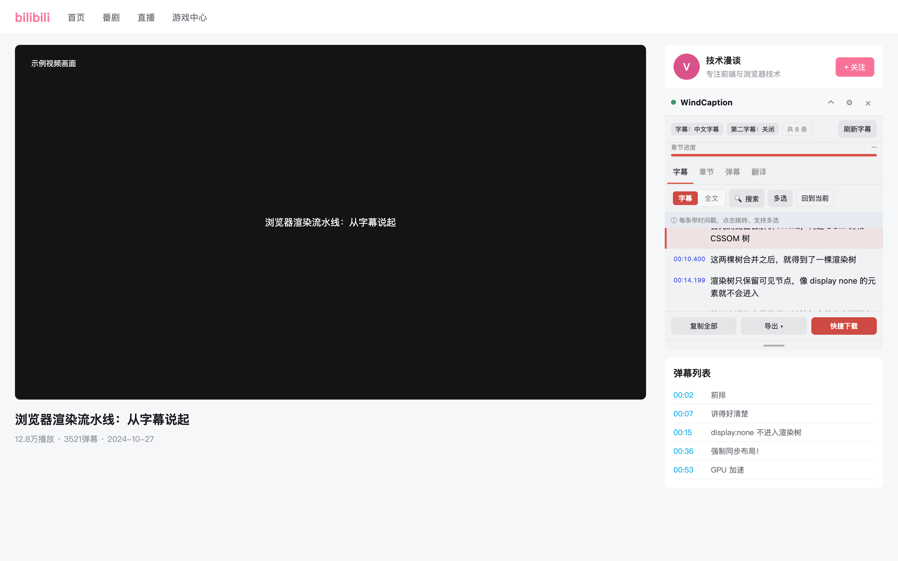

## 安装

只支持 Chrome / Edge（Manifest V3）。

1. 打开 `chrome://extensions`，开启「开发者模式」。
2. 点「加载已解压的扩展程序」，选中本项目目录（含 `manifest.json` 的那一层）。
3. 打开一个带字幕的 B站视频，面板会自动插进视频右侧栏。重新加载扩展后改动的设置才会生效。

面板固定嵌入在视频旁，不覆盖画面，位置不用设置。B站字幕接口大多需要登录，未登录时面板会提示"该视频字幕需要登录 B站 才能获取"——登录并刷新页面即可自动加载。

## 面板能做什么

面板顶部四个 Tab：**字幕 / 章节 / 弹幕 / 翻译**。标题栏右侧三个按钮分别是折叠、设置、关闭；关闭后点页面右下角的「字」可以重新打开。面板底部有拖拽手柄，上下拖动可以在约 10–15 行字幕之间调整高度，松手后记住这个高度。

### 字幕列表

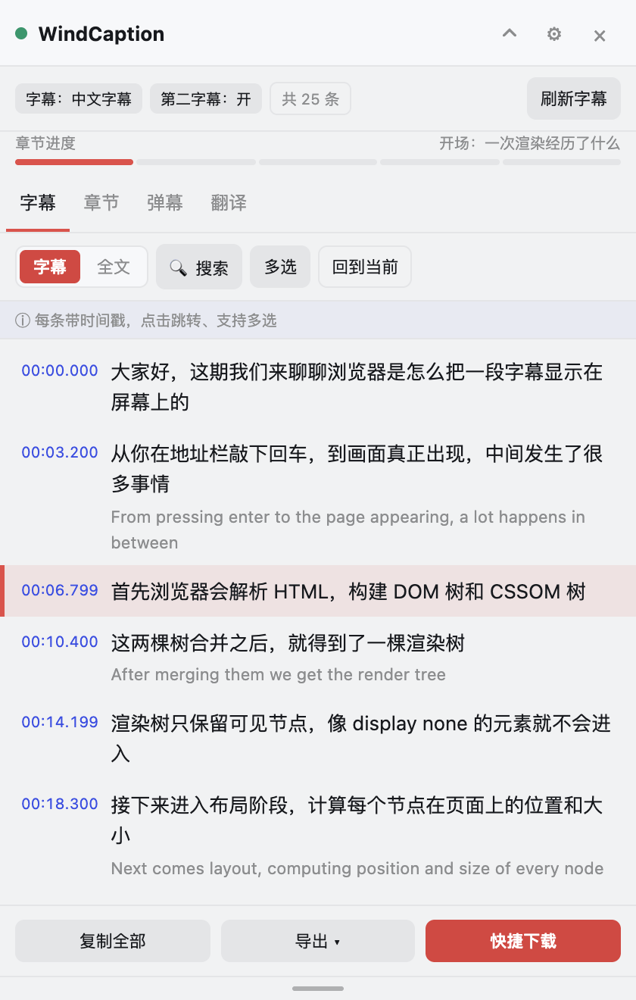

每条字幕带时间戳，点一下跳到对应播放位置；正在播放的那条会高亮，列表自动跟随滚动。如果配了翻译并开启第二字幕，每条下面会多一行译文。顶部小标签显示当前字幕源、第二字幕状态和总条数，「刷新字幕」会重新拉取。

工具栏上的按钮：

- **字幕 / 全文**：在两个视图间切换。
- **搜索**：实时过滤，关键词高亮，字幕和全文视图都能用。
- **多选**：勾选多条后批量复制或发起翻译，支持全选 / 全不选 / 反选。
- **回到当前**：滚动定位回正在播放的句子。

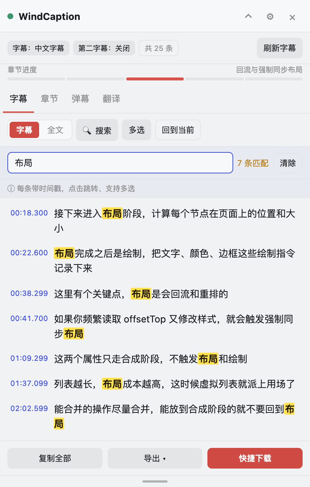

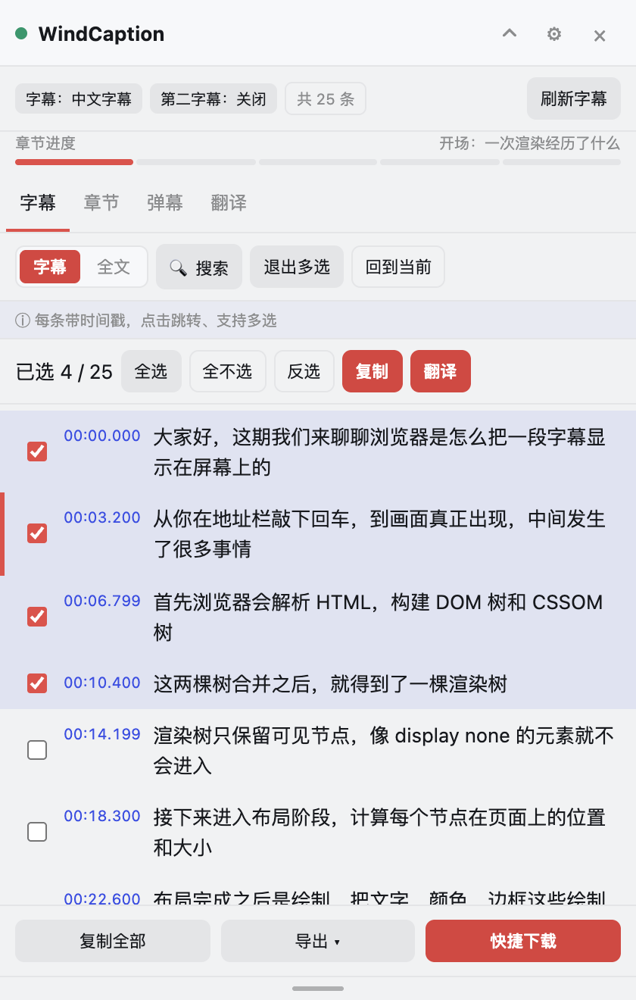

### 全文视图

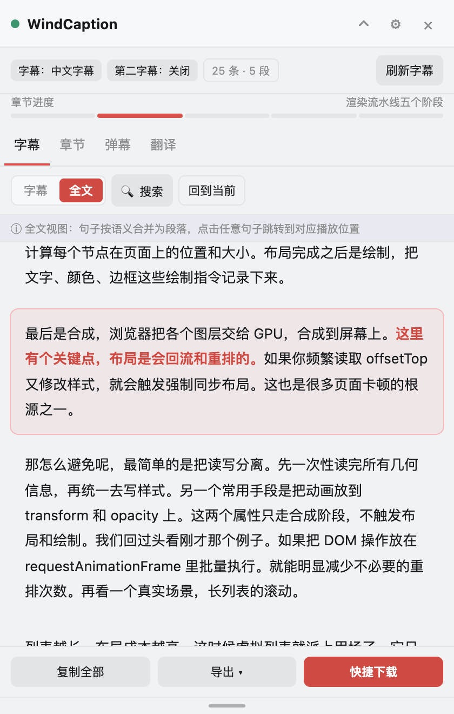

点「全文」后，句子会按语义合并成段落并自动补上标点（中文 / 英文 / 日文各用对应标点）。段落里的每个句子都能点，点了跳到对应播放位置；正在播放的句子用醒目颜色标出。全文视图里没有时间戳和多选，底部的「复制全部」「快捷下载」拿到的是和屏幕上一致的纯文本。

### 章节

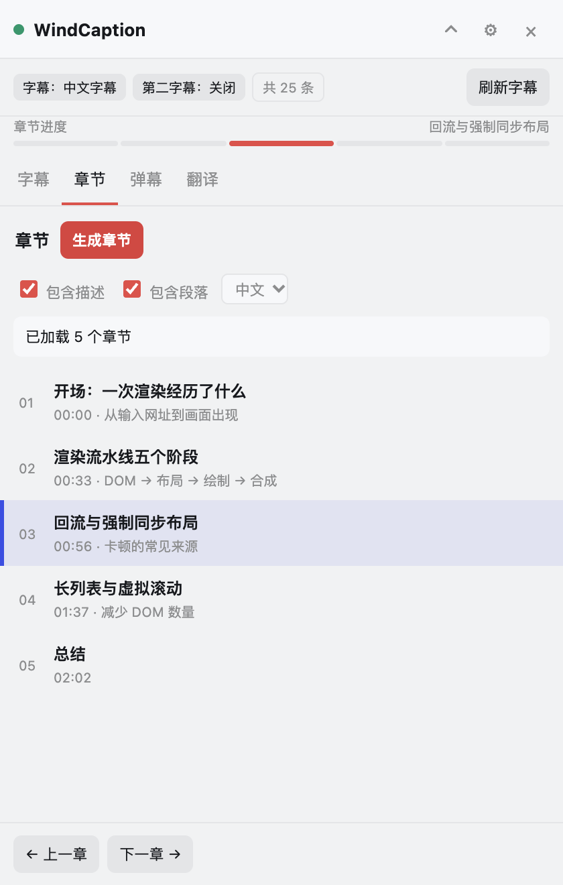

「章节」Tab 列出视频已有的章节（B站 `view_points` 数据），显示序号、标题、时间和描述，点章节跳转，底部有上一章 / 下一章。面板顶部还有一条章节进度条，标出当前所在章节。如果视频没有章节，可以配好 AI 服务后点「生成章节」，让模型按字幕内容切分，可选是否包含描述和段落、生成语言（中文 / 英语 / 日语）。

### 弹幕

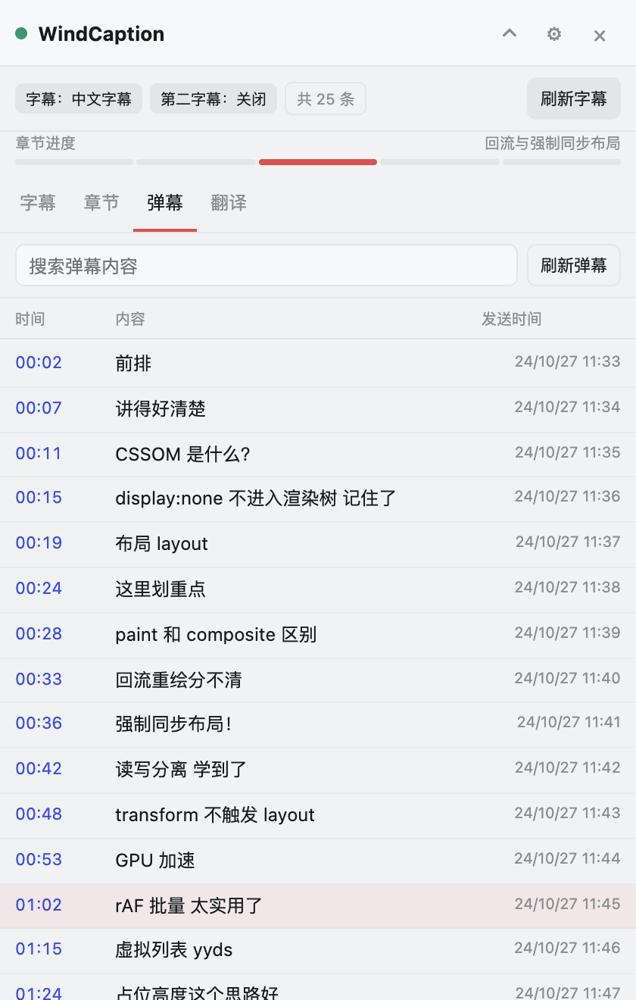

「弹幕」Tab 拉取视频的 XML 弹幕，按视频时间列出时间、内容、发送时间，支持搜索和点击跳转到对应播放位置。设置里的「隐藏官方弹幕」可以隐藏 B站页面自带的弹幕栏，默认关闭（显示）。

### 翻译

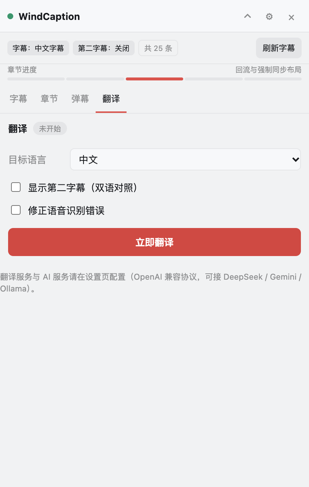

「翻译」Tab 选目标语言（中文 / 英语 / 日语），点「立即翻译」发起任务，显示进度。勾「显示第二字幕（双语对照）」会在字幕列表里同时显示原文和译文；「修正语音识别错误」让模型顺手修一下识别文本。翻译和章节生成都依赖设置页里配置的 AI 服务，没配的话会提示失败。

服务按 BYOK（自带 Key）方式配置，走 OpenAI 兼容协议，可接 OpenAI、DeepSeek、Gemini、Ollama、小牛、DeepL 等。

### 复制与导出

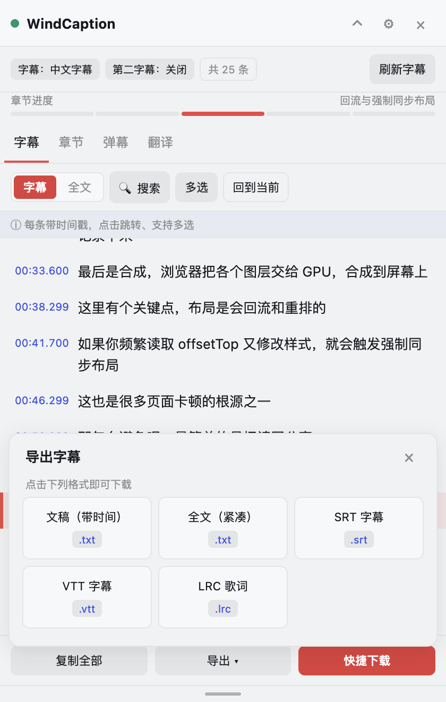

底部三个按钮：「复制全部」复制当前视图的字幕，「导出 ▾」弹出格式列表，「快捷下载」按默认格式直接下载。可选格式：

| 格式 | 说明 | 扩展名 |
|---|---|---|
| 文稿（带时间） | 逐句带时间戳 | `.txt` |
| 全文（紧凑） | 段落合并后的纯文本 | `.txt` |
| SRT 字幕 | 标准字幕格式 | `.srt` |
| VTT 字幕 | WebVTT 格式 | `.vtt` |
| LRC 歌词 | 歌词格式 | `.lrc` |

浏览器全局快捷键：`Command+Shift+C`（Windows 为 `Ctrl+Shift+C`）复制全部字幕，`Command+Shift+D`（`Ctrl+Shift+D`）下载全部字幕，按当前视图的格式处理。

面板获得焦点时还有一组内置快捷键：← / → 上一句 / 下一句，↑ / ↓ 上翻 / 下翻 10 句，空格播放暂停，`c` 复制当前句，`s` 快捷下载，`f` 折叠，`v` 切换字幕 / 全文，`r` 回到当前。这些是固定按键，设置页不提供修改入口。

### 折叠

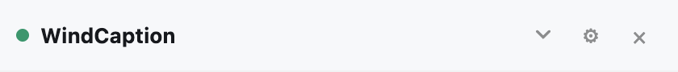

点标题栏左侧的箭头折叠面板，折叠后只留 44px 标题栏，和 B站自己的栏目折叠效果一致；再点一次展开。设置里的「自动折叠」打开后，字幕消失或无字幕时面板会自动收起。

## 设置页

点面板的 ⚙ 图标或浏览器工具栏的扩展图标打开设置页。分三个区：

### 显示配置

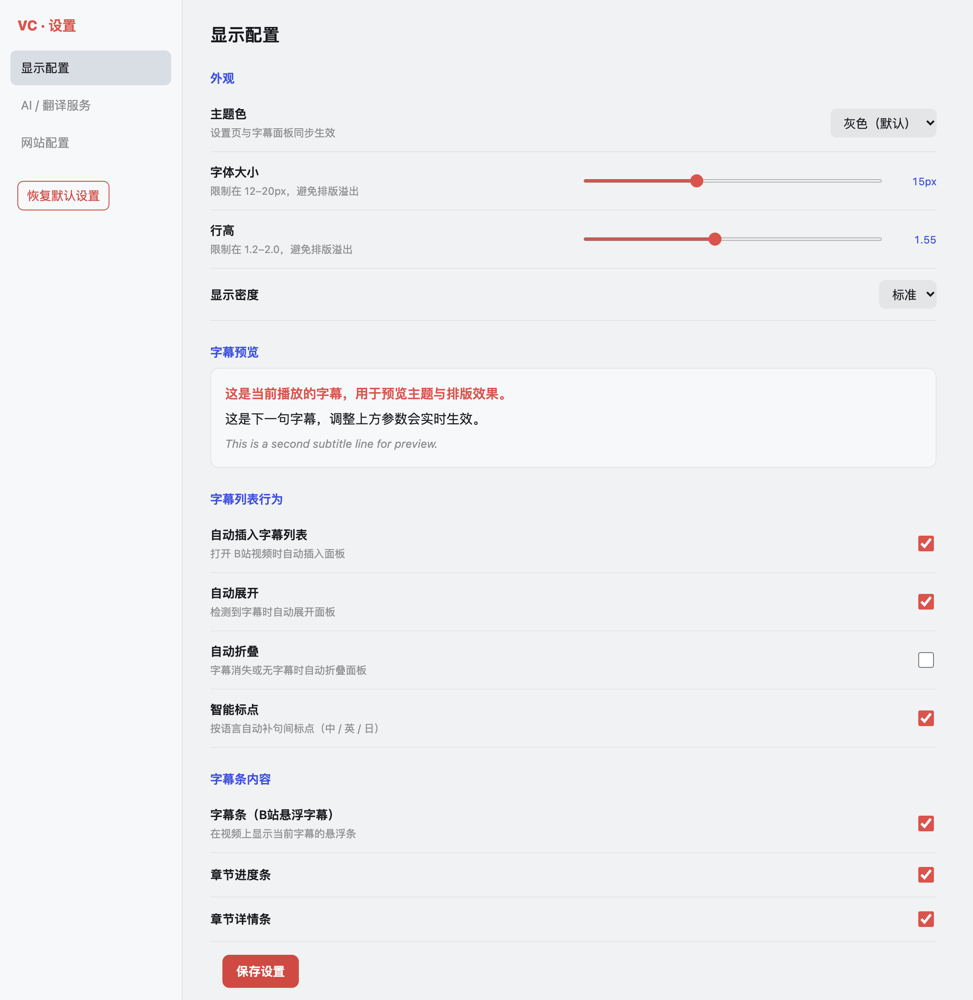

- **外观**：主题色（灰色默认 / 跟随系统 / 深色 / 浅色）、字体大小（12–20px）、行高（1.2–2.0）、显示密度（紧凑 / 标准 / 宽松），都带实时字幕预览。灰色主题是默认值，配色对齐 B站右栏的弹幕列表和 AI 总结卡片。
- **字幕列表行为**：自动插入（打开视频就插面板）、自动展开（检测到字幕就展开）、自动折叠（字幕消失时收起）、智能标点（按语言补标点）。关闭自动插入后，仍可用页面右下角「字」按钮手动打开。
- **字幕条内容**：控制视频上的悬浮字幕条（默认关闭），以及章节进度、章节详情、当前字幕三行的显隐；另有隐藏官方弹幕开关。


### AI / 翻译服务

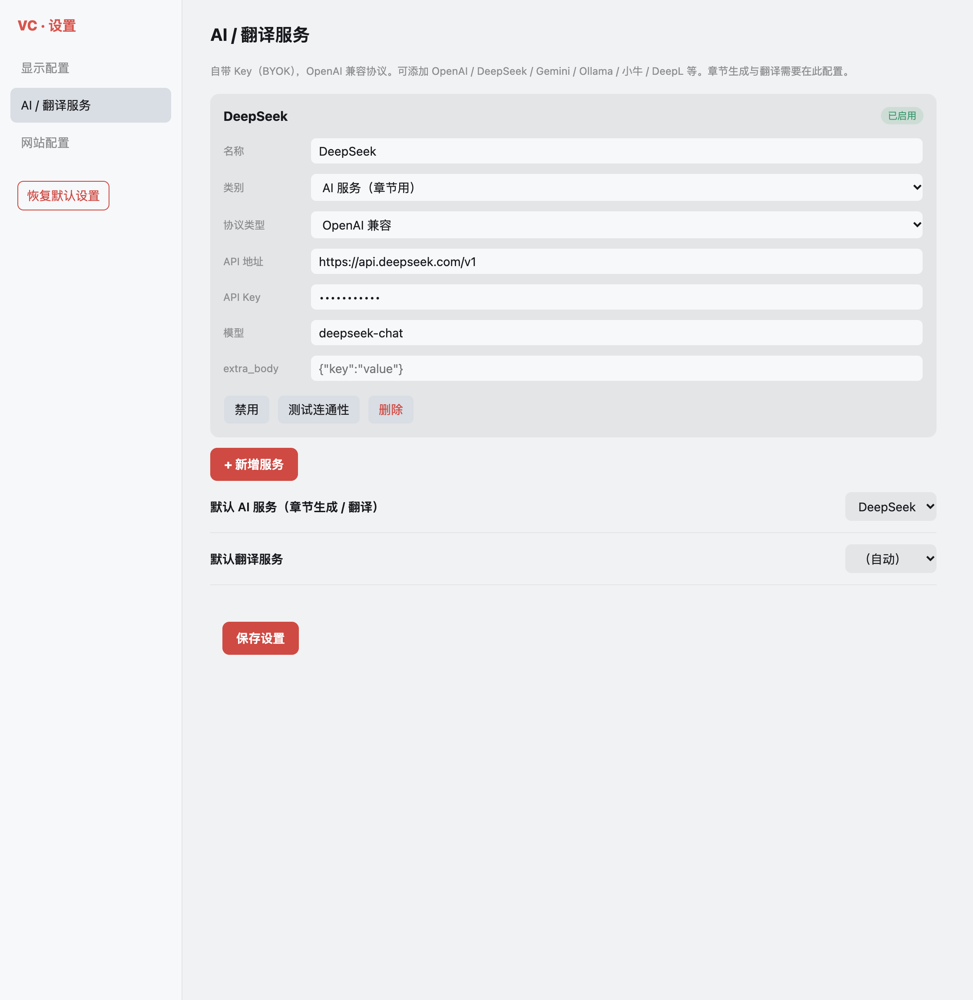

新增服务，填名称、类别（翻译 / AI）、协议类型、API 地址、Key、模型，可测试连通性；指定默认 AI 服务和默认翻译服务。章节生成和翻译从这里取配置。

### 网站配置

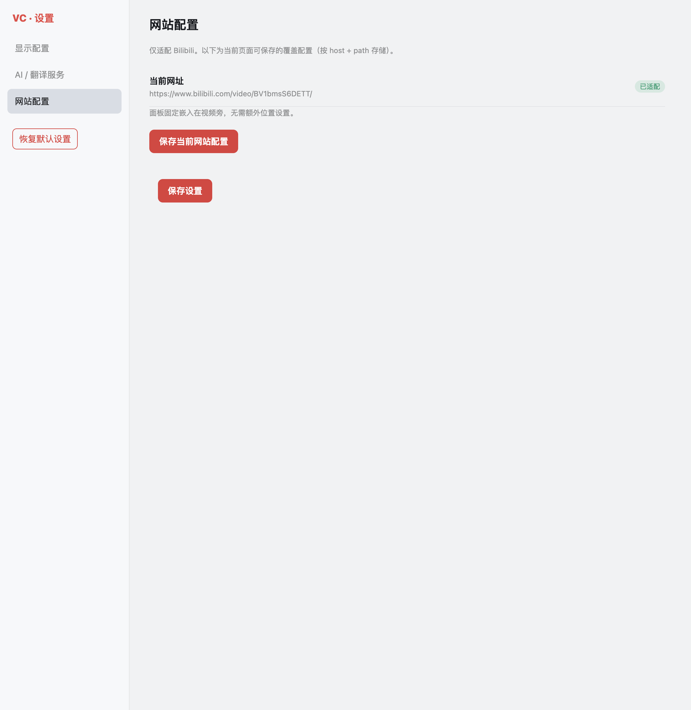

显示当前网址和适配状态，可保存当前页面的覆盖配置（按 host + path 存）。面板固定嵌入视频旁，没有位置选项。

## 字幕是怎么来的

- 字幕从 B站自己的软字幕轨道拿，不做 OCR，也不做音频转写。MAIN 世界脚本拦截字幕网络请求，配合 B站 `view_points` 章节数据和 `player/wbi/v2` 接口解析字幕列表；字幕 JSON 来自 `i0.hdslb.com`。
- 缓存按视频 ID 存在 `chrome.storage.local`，下次打开同一视频直接用；想重新拉取点面板上的「刷新字幕」。
- 大量视频（包括 `BV1nJ396JEmC`）的字幕接口要求登录，所以没登录时拿不到字幕列表，插件会给出提示。登录并刷新页面即可。

## 目录结构

```
manifest.json           扩展清单与权限
background.js           后台：AI 翻译、章节生成、导出指令、快捷键
lib/util.js             字幕解析、分句分段、导出格式、时间格式化
lib/storage.js          设置与字幕缓存读写
lib/protocol.js         iframe 与内容脚本之间的 postMessage 协议
inject/capture-main.js  MAIN 世界字幕网络拦截
content/adapters.js     站点适配
content/main.js         面板注入、视频控制、字幕条、交互
content/inject.css      注入页面的样式
panel/                  面板 UI 与逻辑（4 Tab：字幕/章节/弹幕/翻译）
options/                设置页
screenshots/            本文档使用的截图
prototype/              交互式页面原型（设计稿）
```

## 能力与边界

- 只适配 Bilibili；其他站点不会注入面板。
- 不含账号 / VIP、AI 对话、音频转录、笔记、样式 Tab、YouTube，也没有悬浮窗和浏览器侧边栏模式（历史配置里的 `float` / `side` 会自动回退为嵌入）。
- AI 功能需要自己提供兼容 OpenAI Chat Completions 的服务。
